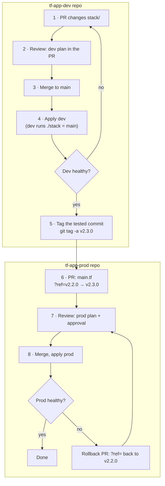
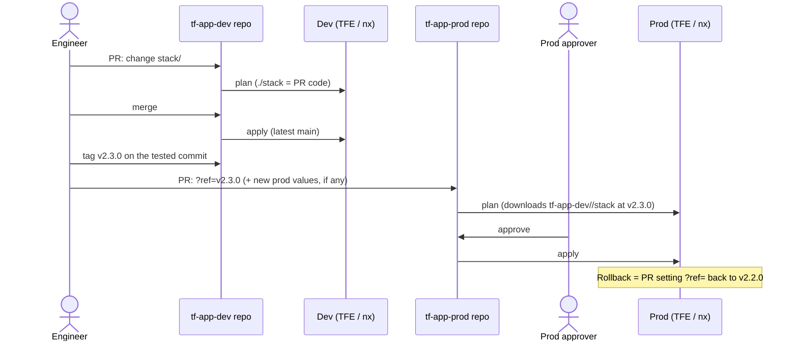
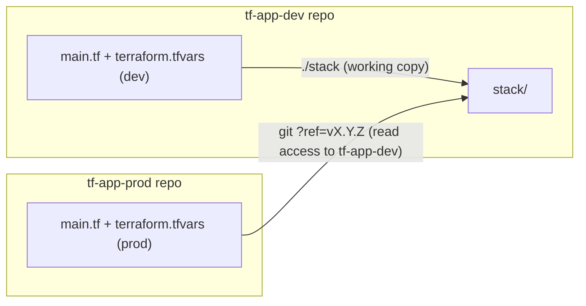
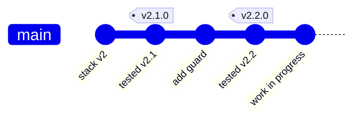

# Pattern 2 · prod reuses the dev code

Two repos per component, as today, but the code exists once. The dev repo holds the code in one folder (the
"stack") and runs it directly. The prod repo holds no code: only prod values and the tag of the dev repo's stack
to run. In this demo both repos are folders: `tf-app-dev/` and `tf-app-prod/`.

## Layout

```
tf-app-dev/                  (repo: tf-app-dev)
├── stack/                   the code, once (Cloud Foundation Fabric modules)
│   ├── main.tf              bucket, topic + subscription, dev-only scratch bucket
│   ├── variables.tf         the only schema: one typed `config` object + validations
│   └── outputs.tf
├── main.tf                  module "app" { source = "./stack" }                       ← always latest
├── variables.tf             variable "config" { type = any }
└── terraform.tfvars         dev values

tf-app-prod/                 (repo: tf-app-prod)
├── main.tf                  module "app" { source = "…tf-app-dev.git//stack?ref=v2.2.0" }  ← pinned tag
├── variables.tf             variable "config" { type = any }
└── terraform.tfvars         prod values
```

| Change                       | Repo / file                          | Reaches dev   | Reaches prod                    |
| ---------------------------- | ------------------------------------ | ------------- | ------------------------------- |
| Code (resources, Fabric pin) | `tf-app-dev` · `stack/*.tf`          | next dev plan | only after a tag + `?ref=` bump |
| Dev values                   | `tf-app-dev` · `terraform.tfvars`    | next dev plan | never                           |
| Prod values                  | `tf-app-prod` · `terraform.tfvars`   | never         | next prod plan                  |
| Promotion / rollback         | `tf-app-prod` · `?ref=` in `main.tf` | —             | next prod plan                  |

Nothing applies by itself: every apply is a reviewed plan (or an auto-apply rule you add for dev in TFE/CI).
Prod applies always need approval.

## Full flow





### Commands for each step

```bash
# 1–4  change stack/, check and apply dev
npx nx run pattern-2-tf-app-dev:validate
npx nx run pattern-2-tf-app-dev:plan
npx nx run pattern-2-tf-app-dev:apply

# 5    release: tag the dev commit that was just applied
git tag -a tf-app-dev-v2.3.0 -m "tf-app stack 2.3.0: <what changed>"   # real repo: v2.3.0
git push origin tf-app-dev-v2.3.0

# 6–8  promote prod: edit ?ref= in tf-app-prod/main.tf, then
npx nx run pattern-2-tf-app-prod:initialize   # re-downloads the stack at the new tag
npx nx run pattern-2-tf-app-prod:plan
npx nx run pattern-2-tf-app-prod:apply
```

What the prod reviewer sees in step 6:

```diff
-  source = "…tf-app-dev.git//stack?ref=v2.2.0"
+  source = "…tf-app-dev.git//stack?ref=v2.3.0"
```

…plus any new prod values in `tf-app-prod/terraform.tfvars` if the release added a setting.

## How the repos connect



What Nx `affected` sees in this demo (the stack is part of the dev project):

| Files changed in a PR           | `nx show projects --affected` |
| ------------------------------- | ----------------------------- |
| `tf-app-dev/stack/*.tf`         | `pattern-2-tf-app-dev`        |
| `tf-app-dev/terraform.tfvars`   | `pattern-2-tf-app-dev`        |
| `tf-app-prod/*` (ref or values) | `pattern-2-tf-app-prod`       |

In real separate repos this is automatic: a dev-repo PR never runs anything in the prod repo.

## Tags

Prod can only point at a git ref, and it must be the commit dev tested, not whatever is on `main` now.



- Dev runs the tip of `main` (`work in progress`); prod runs `v2.2.0`.
- Tags live in the dev repo; prod reads them, so prod needs read access to `tf-app-dev` (TFE/CI).
- Protect tags (no move/delete) and agree who may create them.
- Versioning: patch = no behaviour change, minor = new optional setting, major = breaking input change (e.g.
  `v2.0.0` moved all settings into one `config` object, so prod's values file changed with it).

## Dev-only resources

The stack can create resources only in some environments. `module "scratch_bucket"` has
`count = var.config.scratch_bucket == null ? 0 : 1`: dev's `terraform.tfvars` sets `scratch_bucket`, prod's
does not. A validation in `stack/variables.tf` also rejects `scratch_bucket` when `environment = "prod"`, so it
cannot reach prod through values, a TFE workspace variable, or a future default; the plan fails instead.

## Protecting prod

- Prod keeps its own repo and project: same approvals as today.
- Prod changes are small: a `?ref=` line plus new values, so reviews are fast.
- Tag permissions in the dev repo decide what can become a prod candidate.
- Code guardrails (validations) live with the stack and travel with every tag.

## Local demo note

There is no git remote, so prod's `source` is `git::file:///…/terraform//packages/pattern-2/tf-app-dev/stack?ref=tf-app-dev-v2.2.0`.
In real repos it is `git::https://bitbucket.org/<workspace>/tf-app-dev.git//stack?ref=v2.2.0`, and tags are plain
`vX.Y.Z` (the `tf-app-dev-` prefix only avoids clashes with other patterns in this demo repo).

See also: [pattern 3](../pattern-3/README.md) (code in its own module repo),
[pattern 4](../pattern-4/README.md) (one monorepo).
