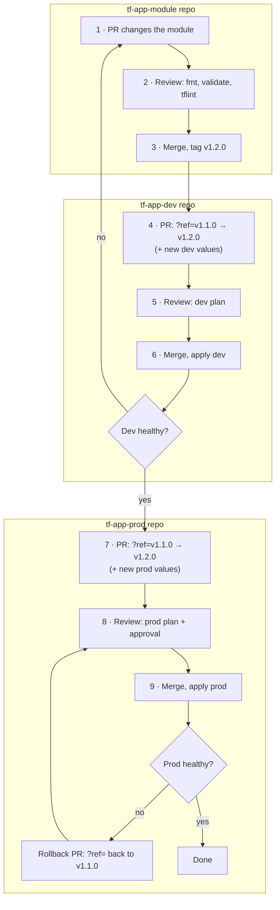
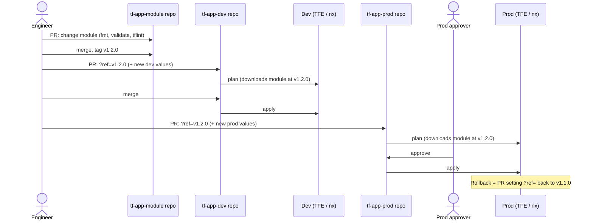
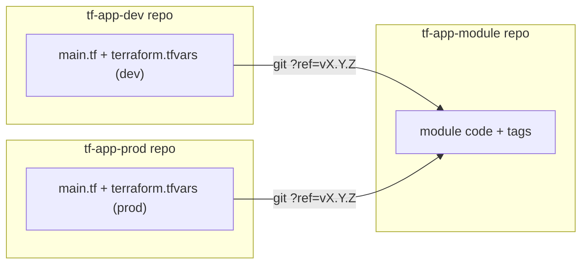
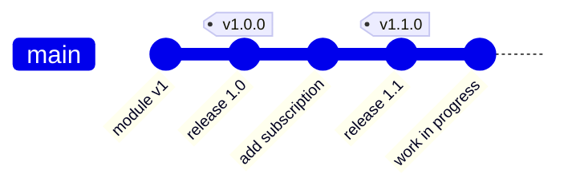

# Pattern 3 · everything is a module

Three repos per component. The code moves to its own module repo; both the dev repo and the prod repo become
thin: a module version plus values. Dev and prod are treated the same way. In this demo the repos are folders:
`tf-app-module/`, `tf-app-dev/` and `tf-app-prod/`.

## Layout

```
tf-app-module/               (repo: tf-app-module) code only, no values, no state
├── main.tf                  bucket, topic + subscription (Cloud Foundation Fabric modules)
├── variables.tf             module inputs (7 variables)
└── outputs.tf

tf-app-dev/                  (repo: tf-app-dev)
├── main.tf                  module "app" { source = "…tf-app-module.git?ref=v1.1.0" }   ← pinned tag
├── variables.tf             declarations for the 7 inputs
└── terraform.tfvars         dev values

tf-app-prod/                 (repo: tf-app-prod)
├── main.tf                  module "app" { source = "…tf-app-module.git?ref=v1.1.0" }   ← pinned tag
├── variables.tf             declarations for the 7 inputs
└── terraform.tfvars         prod values
```

| Change                       | Repo / file                        | Reaches dev                     | Reaches prod                    |
| ---------------------------- | ---------------------------------- | ------------------------------- | ------------------------------- |
| Code (resources, Fabric pin) | `tf-app-module` · `*.tf`           | only after a tag + `?ref=` bump | only after a tag + `?ref=` bump |
| Dev values                   | `tf-app-dev` · `terraform.tfvars`  | next dev plan                   | never                           |
| Prod values                  | `tf-app-prod` · `terraform.tfvars` | never                           | next prod plan                  |
| Upgrade / rollback           | `?ref=` in each env's `main.tf`    | dev's own PR                    | prod's own PR                   |

Nothing applies by itself: every apply is a reviewed plan. Prod applies always need approval.

## Full flow





### Commands for each step

```bash
# 1–3  change the module, check it, release it
npx nx run pattern-3-tf-app-module:fmt
npx nx run pattern-3-tf-app-module:validate
npx nx run pattern-3-tf-app-module:tflint
git tag -a tf-app-module-v1.2.0 -m "tf-app module 1.2.0: <what changed>"   # real repo: v1.2.0
git push origin tf-app-module-v1.2.0

# 4–6  upgrade dev: edit ?ref= in tf-app-dev/main.tf, then
npx nx run pattern-3-tf-app-dev:initialize    # re-downloads the module at the new tag
npx nx run pattern-3-tf-app-dev:plan
npx nx run pattern-3-tf-app-dev:apply

# 7–9  upgrade prod: same ?ref= edit in tf-app-prod/main.tf, then
npx nx run pattern-3-tf-app-prod:initialize
npx nx run pattern-3-tf-app-prod:plan
npx nx run pattern-3-tf-app-prod:apply
```

What the dev and prod reviewers see (steps 4 and 7) is the same kind of change:

```diff
-  source = "…tf-app-module.git?ref=v1.1.0"
+  source = "…tf-app-module.git?ref=v1.2.0"
```

…plus any new values in that env's `terraform.tfvars`, and, while the env apps declare each input separately,
a new `variable` in `variables.tf` and a pass-through line in `main.tf`.

## How the repos connect



What Nx `affected` sees in this demo:

| Files changed in a PR           | `nx show projects --affected` |
| ------------------------------- | ----------------------------- |
| `tf-app-module/*.tf`            | `pattern-3-tf-app-module`     |
| `tf-app-dev/*` (ref or values)  | `pattern-3-tf-app-dev`        |
| `tf-app-prod/*` (ref or values) | `pattern-3-tf-app-prod`       |

A module change runs nothing in dev or prod until their `?ref=` is bumped.

## Tags

Every module change needs a tag before any environment can use it, including dev.



- Dev and prod both run tagged versions; untagged work in progress runs nowhere.
- To try a change in dev before a final release, tag a pre-release (`v1.2.0-rc.1`) and pin dev to it; prod only
  ever pins final tags.
- Dev and prod need read access to `tf-app-module` (TFE/CI). Protect tags (no move/delete).
- Versioning: patch = no behaviour change, minor = new optional input, major = breaking input change.

## Trade-offs vs pattern 2

- Cleanest separation: code, dev values and prod values each in their own repo; easiest to reuse the module
  for a new environment or region.
- Slower day-to-day: even dev needs a tag and a `?ref=` PR to see a change.
- More repos to create, secure and version: about one extra repo per component.
- Duplication still present here: the module and both env apps declare the same 7 variables. The single
  `config` object used in patterns 2 and 4 would leave one schema (in the module) and a
  `variable "config" { type = any }` in each env.

## Local demo note

There is no git remote, so sources are `git::file:///…/terraform//packages/pattern-3/tf-app-module?ref=tf-app-module-v1.1.0`.
In real repos they are `git::https://bitbucket.org/<workspace>/tf-app-module.git?ref=v1.1.0`, and tags are
plain `vX.Y.Z` (the `tf-app-module-` prefix only avoids clashes with other patterns in this demo repo).

See also: [pattern 2](../pattern-2/README.md) (prod reuses dev code), [pattern 4](../pattern-4/README.md)
(one monorepo).
