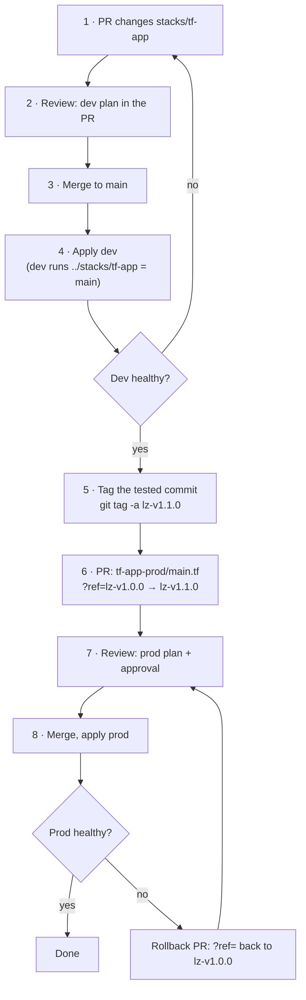
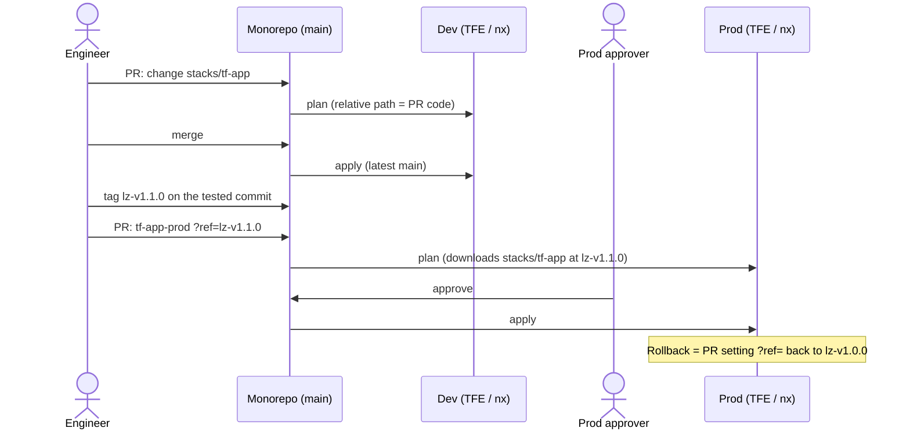
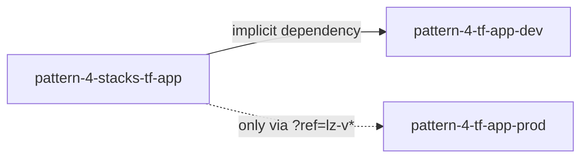
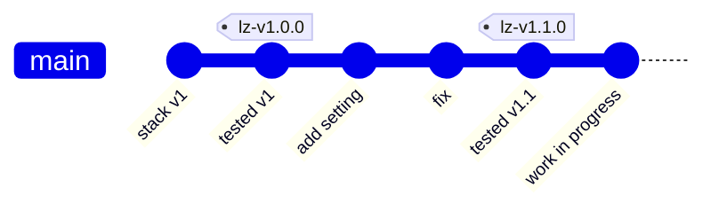

# Pattern 4 · one monorepo

All shared code, dev values and prod values live in one repo, in separate folders. Dev always runs the latest
code; prod runs a tested release that is pinned by one line. One release number (`lz-vX.Y.Z`) covers the whole
landing zone.

## Layout

```
packages/pattern-4/
├── stacks/tf-app/      shared code, once (Cloud Foundation Fabric modules)
│   ├── main.tf         bucket, topic + subscription, dev-only scratch bucket
│   ├── variables.tf    the only schema: one typed `config` object + validations
│   └── outputs.tf
├── tf-app-dev/         dev app
│   ├── main.tf         module "app" { source = "../stacks/tf-app" }          ← always latest
│   ├── variables.tf    variable "config" { type = any }
│   └── terraform.tfvars
└── tf-app-prod/        prod app
    ├── main.tf         module "app" { source = "…//stacks/tf-app?ref=lz-v1.0.0" }  ← pinned release
    ├── variables.tf    variable "config" { type = any }
    └── terraform.tfvars
```

| Change                       | File                             | Reaches dev   | Reaches prod                        |
| ---------------------------- | -------------------------------- | ------------- | ----------------------------------- |
| Code (resources, Fabric pin) | `stacks/tf-app/*.tf`             | next dev plan | only after a release + `?ref=` bump |
| Dev values                   | `tf-app-dev/terraform.tfvars`    | next dev plan | never                               |
| Prod values                  | `tf-app-prod/terraform.tfvars`   | never         | next prod plan                      |
| Release                      | `?ref=` in `tf-app-prod/main.tf` | —             | next prod plan                      |

Nothing applies by itself: every apply is a plan reviewed by a person (or an auto-apply rule you add for dev
in TFE/CI). Prod applies always need approval.

## Full flow





### Commands for each step

```bash
# 1–4  change the code, check and apply dev
npx nx run pattern-4-stacks-tf-app:validate
npx nx run pattern-4-tf-app-dev:plan
npx nx run pattern-4-tf-app-dev:apply

# 5    release: tag the commit dev just ran
git tag -a lz-v1.1.0 -m "landing zone 1.1.0: <what changed>"
git push origin lz-v1.1.0

# 6–8  promote prod: edit ?ref= in tf-app-prod/main.tf, then
npx nx run pattern-4-tf-app-prod:initialize   # re-downloads the stack at the new tag
npx nx run pattern-4-tf-app-prod:plan
npx nx run pattern-4-tf-app-prod:apply
```

What the prod reviewer sees in step 6:

```diff
-  source = "…//stacks/tf-app?ref=lz-v1.0.0"
+  source = "…//stacks/tf-app?ref=lz-v1.1.0"
```

…plus any new prod values in `tf-app-prod/terraform.tfvars` if the release added a setting.

## What Nx `affected` sees

`tf-app-dev` declares `implicitDependencies: ["pattern-4-stacks-tf-app"]`; `tf-app-prod` does not, because it
reads the stack through a tag, not the working copy.



| Files changed in a PR           | `nx show projects --affected`                     |
| ------------------------------- | ------------------------------------------------- |
| `stacks/tf-app/*.tf`            | `pattern-4-stacks-tf-app`, `pattern-4-tf-app-dev` |
| `tf-app-prod/*` (ref or values) | `pattern-4-tf-app-prod`                           |

So CI can run `nx affected -t plan` on every PR: a code change plans dev only; a prod change plans prod only.

## Why tags, even in one repo

Dev and prod read the same folder, but at different moments:



- Dev runs the tip of `main` (`work in progress`), on purpose: that is where changes are tested.
- Prod must not: it runs the commit that was tested and approved. Terraform can only pin a module to a git
  ref, so prod needs a name for that commit.
- A tag is that name: readable (`lz-v1.1.0`), immutable when tags are protected, and it doubles as the
  rollback target and release notes.

Alternatives, if you want no tags:

| Prod pins to    | Example                         | Trade-off                                                                                    |
| --------------- | ------------------------------- | -------------------------------------------------------------------------------------------- |
| Tag (used here) | `?ref=lz-v1.1.0`                | readable, protected, one release number for the landing zone                                 |
| Commit SHA      | `?ref=3b01c89…`                 | no tags to manage; unreadable, easy to pin the wrong commit                                  |
| Release branch  | TFE prod workspace on `release` | no `?ref=` at all; promotion = merge to `release`; prod values must also live on that branch |

## Protecting prod in a shared repo

Prod no longer has its own repo or project, so protection moves to:

- Code owners on `tf-app-prod/` (prod approvers must approve any change there).
- Tag permissions: only release managers may create `lz-v*` tags; tags cannot be moved or deleted.
- TFE: the prod workspace requires manual apply approval.
- Code guardrails: validations in `stacks/tf-app/variables.tf` (e.g. the dev-only `scratch_bucket` is rejected
  when `environment = "prod"`).

## Adding another component

Add `stacks/<name>/`, `<name>-dev/` (relative source, implicit dependency on the stack) and `<name>-prod/`
(`?ref=lz-v*`). A landing-zone release bumps every prod app to the same `lz-v*` in one PR.

## Local demo note

There is no git remote, so prod's `source` is `git::file:///…/terraform//packages/pattern-4/stacks/tf-app?ref=…`.
In the real repo it is `git::https://bitbucket.org/<workspace>/landing-zone.git//stacks/tf-app?ref=lz-v1.1.0`.
This demo repo also contains tags from patterns 2 and 3; a real pattern-4 repo has only `lz-v*` tags.
